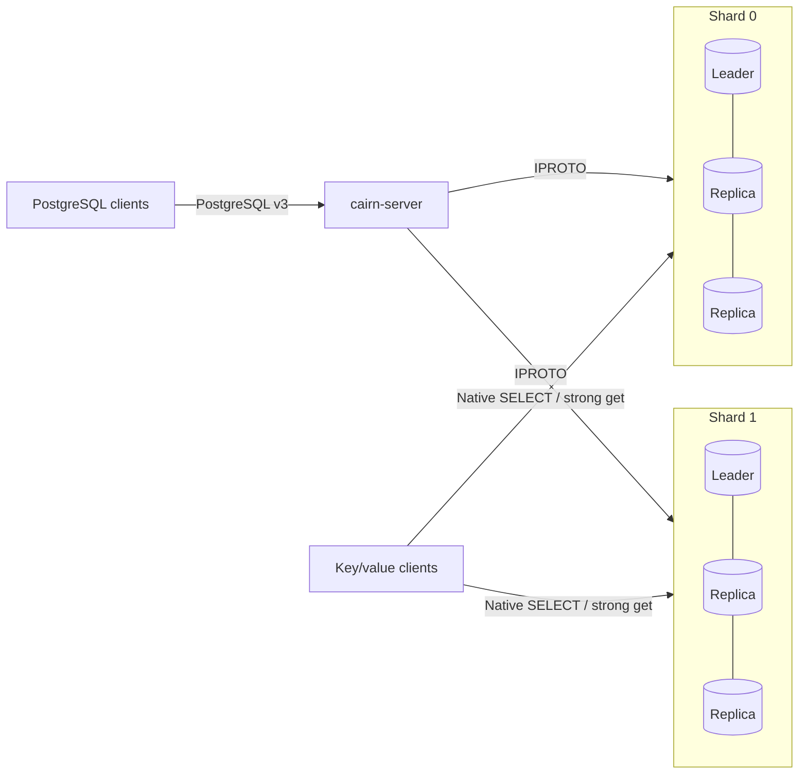

# Cairn

**A distributed PostgreSQL-compatible SQL server on [Tarantool](https://www.tarantool.io), with TLA+-checked transaction protocols and a Verus-verified core.**

[](https://github.com/cstheorist/cairn/actions/workflows/ci.yml)
[](#license)
[](rust-toolchain.toml)

Cairn speaks PostgreSQL's wire protocol and stores each SQL table as an ordinary
sharded Tarantool space. Applications can use PostgreSQL clients or read the same
committed tuples directly through Tarantool's **key/value interface**.

> **Status: research prototype (v0.1).** Replicated shards, automatic failover,
> distributed transactions and a bounded relational executor work. Broader
> PostgreSQL compatibility, operational hardening and the OLTP performance goal
> remain in progress. See [compatibility](docs/sql-compatibility.md) and
> [current performance evidence](bench/RESULTS.md).

## Highlights

* **PostgreSQL clients.** Simple and extended queries, prepared statements, binary
  parameters/results, portal suspension, and transaction/error state handling.
  Psycopg and `tokio-postgres` exercise the actual wire protocol.
* **Native Tarantool tables.** Rows have ordinary tuple formats and primary
  indexes. Each replicated shard has three copies, synchronous WAL durability,
  automatic leader election and epoch fencing.
* **Distributed transactions.** Row and predicate locks, authenticated immutable
  votes, recoverable cross-shard commits, atomic single-shard commits, and
  explicit handling of uncertain commit outcomes.
* **Relational SQL.** Multi-row mutations and `RETURNING`; scans, joins,
  grouping, `COUNT`/`MIN`/`MAX`, ordering, limits and checked expressions.
  Unsupported syntax fails explicitly.
* **Formal checks with executable reuse.** Fourteen Verus-verified functions
  supply the routing, framing, arithmetic and incarnation guards used by Rust.
  Tarantool loads the same arithmetic and incarnation bodies through a native
  library. Eleven bounded TLA+ models, forty negative checks and six
  reachability controls cover specific storage, locking, batching, transport and
  commit contracts.
* **Evidence from running systems.** PostgreSQL differential tests, concurrent
  transfers checked per key, native-storage tests, process/leader failures and
  quorum/partition tests. The benchmark harness checks replication, durability,
  resources, topology and every resulting value.

## Quick start

Docker with Compose is sufficient:

```sh
git clone https://github.com/cstheorist/cairn.git
cd cairn
make up test
```

```sh
PGPASSWORD=local-postgres psql \
  'host=127.0.0.1 port=55432 user=cairn dbname=cairn sslmode=disable'
```

```sql
CREATE TABLE accounts (id BIGINT PRIMARY KEY, value TEXT, enabled BOOLEAN NOT NULL);
INSERT INTO accounts VALUES (42, 'hello', true);
SELECT * FROM accounts WHERE id = 42;
UPDATE accounts SET value = 'updated' WHERE id = 42;
```

Execute each SQL statement separately. `make ha-up` starts two shards with three
replicas each; its SQL port is 55433. The [getting started guide](docs/getting-started.md)
covers the clients, credentials, native ports and local Rust build.

## Read the same row as key/value

```python
import tarantool

# Signed integer key k belongs to (k + 2**63) % shard_count.
# Key 42 belongs to shard 0 in the supplied two-shard cluster.
connection = tarantool.Connection(
    '127.0.0.1', 3301, user='reader', password='local-reader'
)
print(connection.select('accounts', [42]).data)
# [[42, 'updated', True]]
connection.close()
```

Inside Tarantool this is `box.space.accounts:get{42}`. Native readers have per-table
read grants. Raw reads can see follower lag or cross-shard application progress.
For a strong point read, select the writable leader with `cairn.ping` and call
`cairn.get(table, key, term)`; it checks durable write claims and all exclusive
table claims in the same linearizable transaction as the tuple read. In volatile
OPEN mode, private row intents leave the previous committed tuple readable.

## How it works



Autocommit point reads use a bounded per-shard batch and a linearizable storage
barrier. Transactions hold row/table claims and stage writes until their commit
decision is irrevocable. A sole participant installs its rows and durable outcome
atomically. Cross-shard commits require authenticated receipts from every
participant, and recovery completes interrupted outcomes.

The optional volatile-open protocol binds every participant to a storage
incarnation, persists the complete read/write claim set before YES, and combines
the home shard's application and final cleanup. Its failure paths are exercised
alongside the original durable coordinator protocol. See [design](docs/design.md).

## Performance

The goal is strong OLTP performance across point reads, writes and distributed
transactions. It remains open: current development measurements still trail TiDB
on important workloads.

[Benchmarks](bench/RESULTS.md) distinguish repeated historical measurements from
short diagnostics. [The harness](bench/README.md) runs actual YugabyteDB and TiDB
clusters with matched resources and replication, explicit session isolation,
per-key correctness checks and retained source/image hashes. A read-only result
does not establish an OLTP-wide advantage.

## Correctness

* **TLA+:** eleven bounded safety models cover durable storage, replica epochs,
  two-phase commit, predicate locks, read batches, durable votes, local finish,
  volatile state, pipelined transport, committed point visibility and frontend
  cycles. Forty weakened variants must fail their invariants; six controls require reachable
  reads through OPEN claims, partial application and extended-cycle scope changes.
* **Verus:** fourteen checked executable functions, extracted verbatim into
  `crates/cairn-verified`. The storage-side native library shares those bodies.
* **Live tests:** SQL/protocol regressions, PostgreSQL differential cases, native
  receipt/capability checks, 480 concurrent disjoint transfers, and eight
  volatile-state recovery boundaries, in addition to legacy protocol faults.

These checks cover explicit contracts and executions. They are not an end-to-end
proof of the SQL executor, asynchronous orchestration, Lua, cryptography or
Tarantool. [Verification](docs/verification.md) states the boundaries and commands.

## Documentation

| Guide | Contents |
|---|---|
| [Getting started](docs/getting-started.md) | Build, run, SQL clients and native key/value reads |
| [SQL compatibility](docs/sql-compatibility.md) | Supported SQL, types and execution limits |
| [Operations](docs/operations.md) | Configuration, failure handling and security |
| [Design](docs/design.md) | Architecture, locking, commit and recovery |
| [Verification](docs/verification.md) | Models, executable proofs, tests and trusted boundaries |
| [Benchmarks](bench/RESULTS.md) | Method, evidence and current performance gaps |
| [Roadmap](docs/roadmap.md) | Remaining implementation and validation work |

## Repository layout

```text
crates/cairn-server     cairn-server binary and session lifecycle
crates/cairn-pgwire     PostgreSQL wire protocol
crates/cairn-sql        parsing, planning, bounded execution and transactions
crates/cairn-iproto     native Tarantool client, topology and connection pools
crates/cairn-verified   executable Verus core and storage-side native wrapper
crates/cairn-common     schema, columns and PostgreSQL errors
lua/                   storage procedures and replicated bootstrap
tla/                   TLA+ models, configurations and checked output
tests/                 SQL, protocol, concurrency and fault suites
bench/                 load generator, real comparators and evidence
scripts/               cluster helpers, verification and benchmark orchestration
docs/                  user and implementation documentation
```

## Contributing

See [CONTRIBUTING.md](CONTRIBUTING.md) for the development setup and required
checks. Report security and potentially data-corrupting bugs privately as
described in [SECURITY.md](SECURITY.md).

## License

Licensed under either the [MIT license](LICENSE-MIT) or
[Apache License, Version 2.0](LICENSE-APACHE), at your option. Contributions are
dual licensed on the same terms unless explicitly stated otherwise.

## Acknowledgments

Cairn builds on [Tarantool](https://github.com/tarantool/tarantool),
[sqlparser-rs](https://github.com/apache/datafusion-sqlparser-rs),
[Tokio](https://tokio.rs), [Verus](https://github.com/verus-lang/verus) and
[TLA+](https://lamport.azurewebsites.net/tla/tla.html).

[Tarn](https://github.com/cstheorist/tarn) is the independent MySQL counterpart.
Cairn follows its project organization while targeting PostgreSQL's SQL and wire
semantics.
