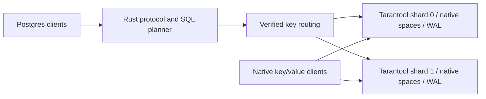

# Architecture and next milestones

## Current data path

The gateway parses a deliberately small PostgreSQL dialect and compiles accepted statements into storage operations. Reconstructing the entire allowlisted SQL statement and comparing its normalized representation prevents unhandled clauses from being ignored. Prepared statements retain plans and types; a gateway catalog cache avoids metadata reads on established query paths. The Lua storage side caches immutable table definitions, too.

The routing function is `(signed_key + 2^63) mod shard_count` using a verified, overflow-free normalization. There is no platform-dependent hash seed. Primary-key checks on storage nodes reject misplaced writes and routed reads. Each table is an ordinary, formatted Tarantool space. This keeps native primary-index reads available without passing through a SQL decoder or an additional index database.

Each shard has eight pooled TCP connections by default, configurable from one to 64. The default transport serializes requests per connection with a five-second deadline. A timed-out or cancelled serial operation drops its stream rather than reusing an unknown response boundary. A transport failure invalidates the generation of every pooled connection to that shard. Later operations reconnect; the failed operation is never replayed. Successful writes return only after the configured Tarantool commit path returns.

Only a complete final response with a unique matching sync and status can become a storage result or SQL error. Unsupported push responses, unknown response types, malformed maps and trailing bytes retire the connection as transport uncertainty. In particular, pushed text resembling a fencing error cannot authorize a mutation retry. A matched final database error leaves the stream aligned and reusable. This follows Tarantool's distinction between [final responses and out-of-band chunks](https://www.tarantool.io/en/doc/latest/reference/internals/iproto/requests/).

`CAIRN_STORAGE_PIPELINE=1` opts into multiplexing on those same pool positions. A dedicated reader owns complete frames; a coalescing writer sends queued packets. Each physical connection admits at most 128 requests and 16 MiB of outstanding encoded request bytes, with the existing 8 MiB response-frame limit. These limits do not bound total decoded/process memory. Cancelled callers retain their SYNC entry and capacity charge until the exact terminal reply is drained or the five-second deadline retires the connection. Other requests cannot acquire that abandoned identity. Fatal replies retire unresolved requests as uncertain; only the matched final pre-execution fence may trigger the existing single retry. Old-connection retirement cannot invalidate an already repaired newer pool generation. [Verification](verification.md) describes the bounded transport model and implementation boundary.

Concurrent autocommit primary-key reads share a bounded per-shard queue. The worker captures up to 64 pending requests before starting one linearizable storage transaction. Requests arriving during that transaction wait for the next capture. Each response echoes its table and key for association checks; oversized read-only replies are split. Explicit transaction reads retain their individual lock-bearing path. This reduces repeated quorum barriers without caching data across requests.

The default deployment has two independent singleton shards. The isolated HA deployment has two three-node replica sets, synchronous user spaces, majority acknowledgement, strict election fencing, leader discovery and linearizable SQL reads. Leader death, quorum loss, a live network partition, and healing are covered by fault tests. Shard migration and membership changes remain pending. First access to an uncached table still requires metadata agreement from every shard.

## Consistency and metadata

All user tables use `memtx`, strict tuple formats, and `wal_mode='fsync'`. SQL and native clients read the same tuples. Transactions use strict two-phase locking and recoverable two-phase commit, with a replicated coordinator on their first participating shard. Single-shard transactions combine decision, row changes and lock release in one synchronous WAL transaction. Cross-shard writes stage in private intents; user tuples change after a durable decision. Public point reads reject durable write claims and all exclusive table claims, while temporary OPEN row intents leave committed tuples readable. Explicit transaction reads and scans retain strict locking. There is no global timestamp service. Raw native reads expose local committed tuples and can observe follower lag or application progress rather than a cross-shard snapshot. See [transaction details](transactions.md).

The relational executor pushes supported primary-key equality predicates into direct lookups. Other inputs use paginated native primary-index scans protected by predicate locks. Joins use an equijoin hash index when possible and a bounded nested loop otherwise. Grouping, DISTINCT and sorting have row, memory and work budgets. Expression UPDATE, multi-row INSERT, DELETE predicates and RETURNING share the durable transaction path. Mode-specific lock indexes restrict MVCC reads to incompatible lock ranges, avoiding dependencies on unrelated compatible writers.

An UPDATE containing one typed integer column increment and an exact primary-key equality can combine its read and intent staging in storage. The increment calls a shared library built from the Verus core. Residual predicates, more complex expressions, primary-key changes and RETURNING retain the relational path. The optimization preserves deferred Sync/COMMIT visibility and all existing transaction locks and receipts.

DDL creates the space, primary index, and local catalog row in one local transaction. Reader grants are repaired on an identical-schema retry. A new gateway verifies each shard's persisted ID/count, and table metadata must agree across all shards before a plan enters its cache. Cluster-wide CREATE is not atomic. Since schema alteration is absent, cached table definitions are immutable. Out-of-band administrator changes are outside this contract.

The PostgreSQL account is one service principal, not a PostgreSQL roles/permissions implementation. The Tarantool gateway account can execute only named storage functions, which run with the owner's permissions. The native reader can only read user spaces. Encryption, SCRAM, tenant isolation, quotas, monitoring, backups, and operational tooling must be added before deployment beyond a trusted development environment.

## Ordered development plan

1. **Replicated shards and safe reads.** Build three-node replica sets with synchronous user spaces, majority acknowledgement, leader fencing and discovery, and an explicit read consistency contract. Prefer Tarantool's existing consensus and election machinery to adding another independent consensus layer. Extend the model to leadership epochs, network partitions, quorum loss, replica lag, and membership changes; verify the gateway's epoch/fencing checks in Verus. Exercise machine failure and partition tests, not just process restart.
2. **Durable cluster metadata and online movement.** Introduce a replicated catalog with schema generations and bucket ownership epochs. Support fenced source/destination transitions, stale-route rejection, and restart-safe migrations before permitting shard-count changes. Evaluate vshard as the migration/routing substrate. Native readers need the same ownership lookup and redirect contract as SQL readers.
3. **Transaction completion and scaling.** Distributed transactions, gateway/coordinator crash recovery, predicate locks, coordinator distribution, PostgreSQL transaction/error state, disconnect cleanup and pipeline rollback are implemented. Add transactional DDL, savepoints, safe metadata reclamation and configurable long-lived transactions.
4. **Broader PostgreSQL compatibility.** Typed expressions, scans, joins, grouping, ordering and transactional DML are implemented. Add secondary indexes, additional data types, catalog queries and broader planner rules. PostgreSQL 16 is the differential reference; expand the supported driver/ORM matrix. Preserve explicit rejection for unsupported semantics throughout.
5. **Comparable performance work.** Profile the prepared primary-key path first. Consider multiplexed iproto, buffer reuse, admission control, and reduced tuple conversions only when measurements show the benefit. Benchmark distributed transactions and scans as separate workload families after they exist.

The replicated deployment distinguishes raw native SELECT from strong native reads. A reader can call `cairn.ping` to find the writable epoch and then `cairn.get(table, key, term)` on that leader. This uses the same linearizable view and durable-write/exclusive-table checks as the public SQL point path. Reading an arbitrary replica's space does not promise a global snapshot or latest committed value.

## Primary references

- [PostgreSQL protocol message flow](https://www.postgresql.org/docs/17/protocol-flow.html), including extended-query errors and Sync recovery.
- [Tarantool documentation](https://www.tarantool.io/en/doc/latest/singlepage/), including MVCC, synchronous replication, native spaces, and linearizable read transactions. Tarantool replication is asynchronous by default; choosing synchronous spaces and safe read transactions is explicit work.
- [Tarantool vshard source and protocol](https://github.com/tarantool/vshard), for bucket movement and routing options.
- [Verus installation and supported platforms](https://github.com/verus-lang/verus/blob/main/INSTALL.md).
- [TLA+ tools](https://github.com/tlaplus/tlaplus).
